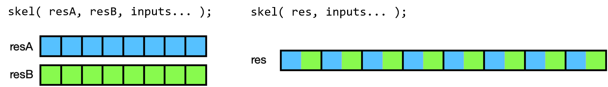

---
format:
  html:
    include-in-header:
      - ../visualizers/viz-shared.html
      - ../visualizers/viz-skeletons.html
---

# SkePU Programming {#sec-programming}

This chapter gives a high-level introduction to programming with
SkePU[^3] For a more thorough description of SkePU, we refer to
Ernstsson [@Ernstsson2022PhD].

## Definitions {#sec-definitions}

Please read through this section once to familiarize yourself with the
terms used in this document. It can then be used as a reference (the
terms defined here are typeset in *italics* at first mention in each
section).

{#fig-map-incr fig-alt="Diagram: a Map skeleton instantiated from an increment user function, and the resulting instance called on input and output containers." width=70%}

Skeleton

:   A generic program construct providing a computational pattern (such
    as map, reduce, stencil, scan etc.), configurable in
    side-effect-free, problem-specific user code, and operating on
    data-containers, e.g., vector or matrix operands. A skeleton exposes
    a sequential-looking interface and encapsulates all implementation
    details such as parallelism, accelerator usage, memory management,
    data transfers etc.

    The skeletons in SkePU are all data-parallel, i.e., the computation
    graph is determined by the dependence structure of container
    parameters and not dependent e.g. on the value of individual
    elements in a data container.

Data-container

:   An object of some SkePU data-container class, i.e., vector, matrix,
    or higher-dimensional tensors. Data containers are homogeneous,
    i.e., contain objects of the same *scalar* (non-container) type. In
    this document, the term \"container\" refers exclusively to SkePU
    data-containers (as opposed to, e.g., raw data pointers or STL
    vectors); in particular, it has nothing to do with operating system
    containers.

Scalar

:   The type of elements in a *data-container*. May be a fundamental
    type such as `float`, `double` or `int` or a compound struct type
    satisfying certain rules. (Note that the compound types are still
    referred to as scalar types when in containers.)

User function

:   A function implementing a per-element operation, used to customize a
    generic skeleton into a *skeleton instance*, and performed
    repeatedly (perhaps in parallel) when executing the skeleton
    instance. A user function in SkePU should not contain side effects,
    with the exception of writing to *random access arguments*.

Skeleton instance

:   An object of some skeleton type instantiated with one or more *user
    functions*, and callable with `(...)`like an ordinary hand-written
    C++ function; see also
    @fig-map-incr for an example.

    A skeleton instance may include *state*, such as

    - a *backend specification*,

    - an *execution plan*, and

    - *skeleton*-specific parameters, such as the initial value for a
      reduction or the overlap sizes for a stencil.

Skeleton (instance) invocation

:   The process of applying a *skeleton instance* to a set of
    parameters. Performs some computation as specified by the instance's
    *skeleton* type and *user function*.

Output argument

:   For the *skeletons* which return a *container*, this container is
    passed as the first argument in a *skeleton invocation*. If the
    skeleton instead returns a *scalar*, no argument is passed and the
    value is instead the evaluated value of the invocation expression
    (i.e., the return value).

Element-wise parameter/argument

:   A *container* argument to a *skeleton instance*, elements of which,
    during *skeleton invocation*, is passed to the corresponding *user
    function* parameter as a scalar value. Iterators into containers can
    also be used for these parameters to narrow down the range of
    accessed elements.

Random access parameter/argument

:   A *container* argument to a *skeleton instance*, which, during
    *skeleton invocation*, is passed as a proxy-container object to the
    corresponding *user function* parameter so that arbitrary elements
    can be accessed by the user function.

Uniform parameter/argument

:   A *scalar* argument to a *skeleton invocation*, passed unaltered to
    each user function call.

Backend

:   The target platform-specific skeleton implementation variant (in
    combination with the required target-specific toolchains, e.g.,
    target compilers) to use when executing a skeleton instance on that
    type of target processing element. SkePU supports multiple backends
    (sequential CPU, OpenMP, CUDA, OpenCL, multi-GPU etc.)

Backend specification

:   An object of type `BackendSpec` to select a backend for execution.
    Encodes a *backend* (e.g., OpenMP) along with backend-specific
    parameters for execution (e.g., number of threads) for use by a
    *skeleton instance*. Overrides *execution plan*s when selecting
    backends.

Tuning

:   The process of training a *skeleton instance* on differently sized
    input data to determine the optimal *backend* in each case.

Execution plan

:   Generated during *tuning* and stored in a *skeleton instance*. Helps
    select the proper *backend* for a certain input size.

Source-to-source translator / precompiler (`skepu-tool`)

:   Clang-based tool which transforms SkePU programs for parallel
    execution. Accepts C++11 code as input and produces C++11 / CUDA /
    OpenCL / OpenMP code as output. Built by user from Clang sources,
    patched with SkePU-provided extensions.

Host compiler

:   User-provided C++11/CUDA compiler which performs the final build of
    a SkePU program, producing an executable. Can also be used on raw
    (non-precompiled) SkePU source for a sequential executable.

## Fundamental SkePU concepts {#sec-concepts}

### The basic Map skeleton structure and its derivatives {#sec-map-family}

*Map* is a term widely used in programming interfaces, sequential as
well as parallel, as a name for a construct that transforms a set of
values to another set of values in accordance with some transformation
(mapping) function $f$. This function is typically a pure function,
deterministic and without side effects, which aids the compiler or
interpreter in automatic program translation and optimization. In a
statically typed language like C++, the types of the domain and image
are fixed but typically they can be different from each other.

SkePU borrows the *map* label for its `Map` skeleton. While `Map` is and
does everything mentioned in the preceding paragraph, its versatility
and importance in SkePU greatly exceeds that of typical map constructs.
`Map` is the *fundamental building block* of the SkePU programming
interface: it is the default building block for encoding data parallel
computations unless a particularly specific pattern is needed, and in
those cases, the vast majority of skeleton patterns in SkePU are
directly based upon the foundations of `Map`. Indeed, the names tell the
story: `MapReduce`, `MapPairs`, `MapPairsReduce`, `MapPool` and
`MapOverlap` are all either specialized variations of `Map` or fusions
with another pattern. The important role played by `Map` means that
understanding the syntax, capabilities, and limitations of this skeleton
is of utmost importance for anyone interested in using or otherwise
learning SkePU.

### Freely accessible containers inside user functions {#sec-randomaccess}

Map patterns often only concern themselves with providing a single
element from the input data set as argument to the mapping operator. To
perform a computation with a non-trivial dependency pattern, the
operators can be defined as *lexical closures* which capture the
enclosing scope, allowing the use of any free variables inside the
operator.

The multi-backend nature of SkePU makes such constructions impractical
from an implementation standpoint.[^4] The backend environments can have
different programming models and the memory spaces are typically
separate from the C++ domain perceived by the SkePU user. SkePU
therefore require that any auxiliary data structures---limited to smart
containers and scalar values---are declared as *bound variables* in the
user function signature. There are particular rules for how these
objects are declared and passed, discussed in
@sec-variadic.

##### Proxy Container Objects in User Functions

SkePU smart containers are C++ objects of intricate class templates, and
cannot be made available in a backend execution context. Therefore,
smart containers as bound variables in user functions are encoded as
*proxy containers*.

@lst-matvecmult-skepu2 illustrates the use of auxiliary
smart containers in the matrix-vector multiplication skeleton instance
`mvmult`[^5] and @fig-scopes illustrates how using proxies bring entire
container data sets into the user function. This is a `Map` instance
with no element-wise inputs, which is a surprisingly powerful construct
enabled by the SkePU design principles presented in
@sec-variadic.

```{#lst-matvecmult-skepu2 .cpp lst-cap="Matrix-vector multiply in the SkePU 2 style, without `MatRow`."}
template<typename T>
T mvmult_f(skepu::Index1D row, const skepu::Mat<T> m, const skepu::Vec<T> v)
{
    T res = 0;
    for (size_t j = 0; j < v.size; ++j)
        res += m(row.i, j) * v(j);
    return res;
}

skepu::Vector<float> y(height), x(width);
skepu::Matrix<float> A(height, width);
auto mvmult = skepu::Map(mvmult_f);
mvmult(y, A, x);
```

### Multi-variadic type signatures {#sec-variadic}

The central aspect of `Map` which gives it its high flexibility and
expressive power compared to many other skeleton programming frameworks
is the *multi-variadic interface*. [^6] The underlying C++-11 features
which enable this generational leap[^7] are designed to be used by
framework engineers, and the significant complexity of implementation is
elegantly hidden beneath the framework boundaries. For the SkePU user,
it means that using the map construct is very easy for trivial
computations but enables great adaptivity for more involved situations.

A `Map` skeleton instance and the corresponding user function are
*four-way variadic*. Arguments of a call to the instance are effectively
grouped into four sets:

- output arguments (see
  @sec-multi-return),

- element-wise input arguments,

- random-access input arguments, and

- uniform input arguments.

The size (henceforth *arity*) of each group is flexible and up to the
user to choose based on the use-case at hand. The only restriction is
that there has to be at least one output argument. All `Map`-like
skeletons in SkePU use the output container to determine the *degree of
parallelism*: each element corresponds to an invocation of the user
function and is an independent task that could be mapped and scheduled
for execution as a unit. It does not matter how each group is ordered
internally, but the relative order of each group must be taken: outputs
come first, followed by element-wise containers (if any), followed by
random-access containers (if any), and finally uniform scalars (if any).

Element-wise (\"elwise\") parameters in a user function are scalar
values (or user types, see [@Ernstsson2022PhD] ), with the corresponding
arguments in a skeleton invocation being SkePU containers. Each element
of the container is uniquely mapped to the parameter of a single user
function invocation, in a data-parallel fashion. Random access
parameters and arguments are both containers (but expressed slightly
differently, as explained later) and all elements are accessible from
within a single user function invocation.

In user function definitions, the function signature encodes the outputs
as the return type of the function and the rest of the arguments come
within the parentheses. Extra care has to be observed when crafting a
user function, since SkePU uses the function signature when determining
the type information for a skeleton instance. Because random-access
container arguments are represented as *container proxy types* (see
@sec-randomaccess ) in the user function signature, the four
groupings have natural separations in the type system. SkePU uses
template meta-programming and the pre-compiler to analyze the types in
the function header and construct the internal groupings.
@fig-scopes
contains an illustration of how the parameter groups bring data from the
arguments into the user function in different ways.

Astute readers may notice that the random-access container group is
allowed to be empty, in which case the distinction between where the
element-wise arguments end and the uniform scalars begin is unavailable.
A `Map` instance definition can optionally contain an explicit template
argument, as in `auto instance = skepu::Map<N>(...);` where `N` denotes
the element-wise arity, and if not present in the construct, SkePU will
make a best-guess deduction based on the parameter list (the *formal
arguments*) of the user function. Skeleton instances are fully
statically typed, so if the deduced arity differs from the *actual
arguments* at the skeleton invocation site, a compile-time error
occurs.[^9]

### Multi-valued return {#sec-multi-return}

{#fig-maptuple fig-alt="Diagram comparing the memory layout of multi-valued return, with one output container per value, to a manually managed array of structs." width=99%}

SkePU 3 introduced tuple-like return functionality for cases where a
single skeleton instance requires multiple (element-wise) output
containers. This way, multiple return values can be computed by the same
user function, operating on the inputs in one sweep, potentially
improving data locality compared to two separate skeleton invocations
after each other. Although the values are returned in a tuple-like
manner, the output containers are completely separate objects (see
@fig-maptuple). This distinguishes this new feature from the
use of custom structs (\"user types\", see [@Ernstsson2022PhD] ) as
return values, as those are stored in array-of-records format.

To use this feature, we specify the return type in the user function
signature as `skepu::multiple<T, [U, ...]>`, i.e., analogous to
`std::tuple`. Then, at the site of the `return` statement, we construct
this compound object by `skepu::ret(expr, [expr, ...])`.

@lst-multireturnuf shows an example of a user function
utilizing multi-valued return.

```{#lst-multireturnuf .cpp lst-cap="User function with multi-valued return."}
skepu::multiple<int, float>
multi_f(int a, int b, skepu::Vec<float> c, int d)
{
    return skepu::ret(a * b, (float)a / b);
}
```

The skeleton instance declaration and invocation follows the syntax of
ordinary `Map`, but instead of supplying one output container as the
first argument, specify several of the correct types and order, as in
@lst-multireturnuse.

```{#lst-multireturnuse .cpp lst-cap="Using multi-valued return with `Map` in SkePU 3."}
skepu::Vector<int> v1(size), v2(size), r1(size);
skepu::Vector<float> e(1);

auto multi = skepu::Map<2>(multi_f);

multi(r1, r2, v1, v2, e, 10);
```

Multi-valued return statements are available in the skeletons which
follow the typical map pattern: `Map`, `MapPairs`, and `MapOverlap`.

### Index-dependent computations {#sec-index}

Another feature of Map-derived SkePU skeletons is the option to access
the index for the currently processed container element to the user
function. This is handled automatically, deduced from the user function
signature. An index parameter's type is one out of four types: `IndexND`
where `N` is the dimensionality of the index, as shown in the type
declarations in
@lst-indexset.[^10]

```{#lst-indexset .cpp lst-cap="Index types corresponding to each smart container."}
struct Index1D { size_t i; };
struct Index2D { size_t row, col; }; // note!
struct Index3D { size_t i, j, k; };
struct Index4D { size_t i, j, k, l; };
```

The Mandelbrot fractal generation in the SkePU example programs
collection (@sec-examplecollection) is a typical example of a
computation where the user function is reliant on the current index into
the resulting `Matrix` container.

## Skeletons {#sec-skeletons}

SkePU provides a number of skeletons which represent different
*data-parallel* patterns, SkePU 3.3 (2025) encompasses currently nine
different skeletons:

- `Map`,

- `Reduce`,

- `MapReduce`,

- `Scan`,

- `MapOverlap`,

- `MapPool`,

- `MapPairs`, and

- `MapPairsReduce`.

The skeletons can be loosely ordered into three groups: the map-based
`Map`, `MapPairs`, and `MapOverlap`, being element-wise transformations
of data; `Reduce` and `Scan`, two forms of data accumulation patterns
with internal dependency structures; and explicit *fusions* of a
map-based skeleton in sequence with some form of reduction in
`MapReduce` and `MapPairsReduce`.

@tbl-featuretable summarizes skeleton attributes and
features to show similarities and differences between them.

:::: {.feature-matrix}
::: {.content-visible when-format="pdf"}
```{=latex}
\begingroup\scriptsize\setlength{\tabcolsep}{3pt}
```
:::

::: {#tbl-featuretable}
  **Feature**       **Skeleton:**   `Map`          `MapPairs`    `MapOverlap`     `MapPool`      `Reduce`   `Scan`   `MapReduce`   `MapPairsReduce`
  --------------------------------- -------------- ------------- ---------------- -------------- ---------- -------- ------------- ------------------
  Elwise dimension in               1--4           1             1--4             1--4           1--4\*\*   1        1--2          1
  Elwise dimension out              Same as *in*   2             Same as *in*     Same as *in*   0--1       1        0             1
  Indexed                           Yes            Yes           Yes              Yes            --         --       Yes           Yes
  Multi-return                      Yes            Yes           Yes              Yes            --         --       Yes           Yes
  Elwise parameters                 Variadic       Variadic x2   1\*\*\*                         \*         \*       Variadic      Variadic x2
  Full proxy parameters             Variadic       Variadic      Variadic         Variadic       --         --       Variadic      Variadic
  Uniform parameters                Variadic       Variadic      Variadic         Variadic       --         --       Variadic      Variadic
  Region/pool proxy                 --             --            `Region`$X$`D`   `Pool`$X$`D`   --         --       --            --
  MatRow/MatCol proxy               Yes            Yes           --               --             --         --       Yes           Yes
  PRNG stream arg.                  Yes            Yes           --               --             --         --       Yes           Yes
  Element strides                   Variadic 1D    --            Dimensional      Dimensional    --         --       --            --

  : Skeleton Feature Matrix  (adapted from Ernstsson
  [@Ernstsson2022PhD])
:::
::: {.content-visible when-format="pdf"}
```{=latex}
\endgroup
```
:::

::: flushleft
Footnotes:

\* Parameters to the user functions can be raw elements from the
container or partial results, depending on evaluation

\*\* Dimensions higher than 2 are linearized in the current
implementation.

\*\*\* A `Region`$X$`D` or `Pool`$X$`D` proxy object providing access to
elements surrounding the current index is supplied.
:::
::::

Each skeleton encodes a computational pattern which is
efficiently parallelized. In general, the skeletons are differentiated
enough to make selection obvious for each use case. However, there is
some overlap; for example, MapReduce is an efficient combination of Map
and Reduce in sequence. This makes Reduce a special case of MapReduce.

Most of the skeletons are very flexible in how they can be used. All but
Reduce and Scan are variadic, and some have different behaviors for one-
and two-dimensional computations.

Skeletons in SkePU are instantiated by calling factory functions named
after the skeletons, returning a ready-to-use skeleton *instance*. The
type of this instance is implementation-defined and can only be declared
as `auto`. This has the consequence of an instance not being possible to
declare before definition, passed as function arguments, etc., which is
important to consider when architecting applications based on
SkePU[^11].

SkePU guarantees, however, that a skeleton instance supports a basic set
of operations (a \"concept\" in C++ parlance).

`instance(`*`args...`*`)`

:   *Invokes* the instance with the arguments. Specific rules for the
    argument list applies to each skeleton.

`instance.tune()`

:   Performs *tuning* on the instance.

`instance.setBackend(`*`backendspec`*`)`

:   Sets a *backend specification* to be used by the instance and
    overrides the automatic choice.

`instance.resetBackend()`

:   Clears a backend specification set by `setBackend`.

`instance.setExecPlan(`*`plan`*`)`

:   Sets the execution plan manually. The plan should be heap-allocated,
    and ownership of it is immediately transferred to the instance and
    cannot be de-referenced by the caller anymore.

### Map {#sec-map}

The fundamental property of `Map` is that it represents a set of
computations without dependencies. The amount of such computations
matches the size of the *element-wise* container arguments in the
*application* of a `Map` *instance*. Each such computation is a call to
(application of) the user function associated with the `Map` instance,
with the element-wise parameters taken from a certain position in the
inputs. The return value of the user function is directed to the
matching position in the output container.

`Map` can additionally accept any number of *random access* container
arguments and *uniform* scalar arguments.

When *invoking* a `Map` skeleton, the output container (required) is
passed as the first argument, followed by element-wise containers all of
a size and format which matches the output container. After this comes
all random-access container arguments in a group, and then all uniform
scalars. The user function signature matches this grouping, but without
a parameter for the output (this is the return value) and the
element-wise parameters being scalar types instead. The return value is
the output container, by reference.

An example can be found in
@lst-map.

{#fig-diag-map fig-alt="Diagram of the operand access scopes of the Map skeleton." width=70%}

```{#lst-map .cpp lst-cap="Example usage of the `Map` skeleton."}
#include <skepu>
#include <skepu-lib/io.hpp>

int sum(int a, int b)
{
  return a + b;
}

int main()
{
  skepu::Vector<int> v1{1, 2, 3, 4}, v2{4, 3, 2, 1};
  skepu::Vector<int> result(v1.size());

  auto vsum = skepu::Map(sum);
  vsum(result, v1, v2);

  skepu::io::cout << result << "\n"; // Prints 5 5 5 5
  return 0;
}
```



::: {.content-visible when-format="html"}
```{=html}

```
:::

#### OpenMP Scheduling Modes {#sec-openmpsched}

The OpenMP backend in SkePU 3 has changed. It is now possible to control
the scheduling mode, as the implementation uses the `runtime` option for
OpenMP loop scheduling. The options are static scheduling (default),
dynamic scheduling, guided dynamic scheduling, or letting the OpenMP
runtime decide. Examples can be found in
@lst-backendspec.

```{#lst-backendspec .cpp lst-cap="Examples of explicit backend specifications with backend-specific settings."}
skepu::BackendSpec spec{...};

// OpenMP
spec.setType(skepu::Backend::Type::OpenMP);
spec.setSchedulingMode(skepu::Backend::Scheduling::Static);
spec.setSchedulingMode(skepu::Backend::Scheduling::Dynamic);
spec.setSchedulingMode(skepu::Backend::Scheduling::Guided);
spec.setSchedulingMode(skepu::Backend::Scheduling::Auto);
spec.setCPUChunkSize(/*int*/);

// CUDA + OpenCL
spec.setType(skepu::Backend::Type::CUDA);
spec.setType(skepu::Backend::Type::OpenCL);
spec.setDevices(/*int*/); // number of GPUs to use (default: all)
spec.setGPUThreads(/*int*/);
spec.setGPUBlocks(/*int*/);

// Hybrid
spec.setType(skepu::Backend::Type::Hybrid);
spec.setCPUPartitionRatio(/*float*/); // CPU fraction, range [0, 1]
```

### Reduce {#sec-reduce}

Reduce performs a standard reduction. Two modes are available: 1D
reduction on vectors or matrices and 2D reduction on matrices only. An
instance of the former type accepts a vector or a matrix, producing a
scalar respectively a vector, while the latter only works on matrices.
For matrix reductions, the primary direction can be controlled with a
parameter on the instance.

The reduction is allowed to be implemented in a tree pattern, so the
user function(s) should be associative.

`instance.setReduceMode(`*`mode`*`)`

:   Sets the reduce mode for matrix reductions. The accepted values are
    `ReduceMode::RowWise` (default) or `ReduceMode::ColWise`.

`instance.setStartValue(`*`value`*`)`

:   Sets the start value for reductions. Defaults to a
    default-constructed object, which is `0` for built-in numeric types.

An example can be found in
@lst-reduce-example.

```{#lst-reduce-example .cpp lst-cap="Example usage of the `Reduce` skeleton."}
#include <skepu>
#include <skepu-lib/io.hpp>

int minimum(int a, int b)
{
  return (a < b) ? a : b;
}

int main()
{
  skepu::Vector<int> v{5, 2, 4, 1, 3};

  auto vmin = skepu::Reduce(minimum);
  vmin.setStartValue(v(0)); // start value defaults to 0 otherwise
  int result = vmin(v);

  skepu::io::cout << result << "\n"; // Prints 1
  return 0;
}
```

::: {.content-visible when-format="html"}
```{=html}

```
:::

```{#lst-reduce-mtv-vts-example .cpp lst-cap="Reduction from matrix to vector, and from vector to scalar."}
#include <skepu>
#include <skepu-lib/io.hpp>

int sum(int a, int b)
{
  return a + b;
}

int main()
{
  skepu::Matrix<int> m(5, 5, 1); // Constructs a 5x5 matrix, each element set to 1
  skepu::Vector<int> v(5); // Constructs a vector of length 5
  
  auto summer = skepu::Reduce(sum);
  summer(v, m);
  
  skepu::io::cout << v << "\n"; // Prints 5.... 5 5 5 5 5
  
  summer.setStartValue(0);
  int result = summer(v);
  
  skepu::io::cout << result << "\n"; // Prints 25

  return 0;
}
```


```{#lst-reduce-mts-example .cpp lst-cap="Reduction from matrix to scalar."}
#include <skepu>
#include <skepu-lib/io.hpp>

int sum(int a, int b)
{
  return a + b;
}

int main()
{
  skepu::Matrix<int> m(5, 5, 1); // Constructs a 5x5 matrix, each element set to 1
  
  auto summer = skepu::Reduce(sum, sum);
  summer.setStartValue(0);
  int result = summer(m);
  
  skepu::io::cout << result << "\n"; // Prints 25

  return 0;
}
```


```{#lst-reduce-modes-example .cpp lst-cap="Difference between colwise and rowwise reduction on a matrix."}
#include <skepu>
#include <skepu-lib/io.hpp>

int sum(int a, int b)
{
  return a + b;
}

int main()
{
  skepu::Matrix<int> m(5, 5); // Constructs a 5x5 matrix
  skepu::Vector<int> v(5); // Constructs a vector of length 5

  skepu::external([&]{
    int val = 1;
    for (int row = 0; row < m.total_rows(); ++row)
    {
      for (int col = 0; col < m.total_cols(); ++col)
        m(row, col) = val;
      val += 1;
    }
  }, skepu::write(m));

  skepu::io::cout << m << "\n";
  // Prints:
  // Matrix: (5 X 5)
  // 1 1 1 1 1
  // 2 2 2 2 2
  // 3 3 3 3 3
  // 4 4 4 4 4
  // 5 5 5 5 5

  auto summer = skepu::Reduce(sum);
  summer.setReduceMode(skepu::ReduceMode::RowWise);
  summer(v, m);
  
  skepu::io::cout << v << "\n"; // Prints 5.... 5 10 15 20 25
  
  summer.setReduceMode(skepu::ReduceMode::ColWise);
  summer(v, m);
  
  skepu::io::cout << v << "\n"; // Prints 5.... 15 15 15 15 15

  return 0;
}
```


#### Pending Revisions to Reduce Skeleton {#sec-reduce-new}

The `Reduce` skeleton and the reduce step of `MapReduce` is seeing some
changes in SkePU 3.

Reduce modes will be revised to not always trigger data rearrangement
such as transposition (sublinear extra memory complexity).

A define is available to enable the old behavior up to a set container
size,\
`-DSKEPU_REDUCE2DCOL_TRANSPOSE_SIZE_MAX [n]`.

The revisions to the `MapReduce` skeleton includes the availability of
an additional reduce mode: not only reduction over the entire container
span, but also reduction over the innermost dimension (row-wise for
matrices).

### MapReduce {#sec-mapreduce}

`MapReduce` is a combination of `Map` and `Reduce` in sequence and
offers the most features of both, for example, only 1D reductions are
supported.

An instance is created from two user functions, one for mapping and one
for reducing. The reduce function should be associative.

`instance.setStartValue(`*`value`*`)`

:   Sets the initial value for reduction. Defaults to a
    default-constructed object, which is `0` for built-in numeric types.

An example use of `MapReduce`, a dot product computation, can be found
in
@lst-mapreduce-example. The elementwise-access operand
arity specifier `<2>` is not really necessary here, as the SkePU
implementation can infer it automatically from the signatures of the
user functions used at instantiation of the `MapReduce` skeleton.

```{#lst-mapreduce-example .cpp lst-cap="Example usage of the `MapReduce` skeleton."}
float add(float a, float b)
{
    return a + b;
}

float mult(float a, float b)
{
    return a * b;
}

float dot_product(Vector<float> &v1, Vector<float> &v2)
{
    auto dotprod = MapReduce<2>(mult, add);
    return dotprod(v1, v2);
}
```

### Scan {#sec-scan}

`Scan` performs a generalized prefix sum operation, either inclusive or
exclusive.

When *invoking* a `Scan` skeleton, the output container is passed as the
first argument, followed by a single input container of equal size to
the first argument. The return value is the output container, by
reference.

`instance.setScanMode(`*`mode`*`)`

:   Sets the scan mode. The accepted values are `ScanMode::Inclusive`
    (default) or `ScanMode::Exclusive`.

`instance.setStartValue(`*`value`*`)`

:   Sets the start value for exclusive scan. Defaults to a
    default-constructed object, which is `0` for built-in numeric types.

An example can be found in
@lst-scan-example.

```{#lst-scan-example .cpp lst-cap="Example usage of the `Scan` skeleton."}
#include <skepu>
#include <skepu-lib/io.hpp>

int sum(int a, int b)
{
  return a + b;
}

int main()
{
  skepu::Vector<int> v{1, 1, 1, 1, 1};
  skepu::Vector<int> result(v.size());

  auto vscan = skepu::Scan(sum);
  vscan.setScanMode(skepu::ScanMode::Inclusive);
  vscan(result, v);

  skepu::io::cout << result << "\n"; // Prints 1 2 3 4 5

  vscan.setScanMode(skepu::ScanMode::Exclusive);
  vscan(result, v);

  skepu::io::cout << result << "\n"; // Prints 0 1 2 3 4
}
```

::: {.content-visible when-format="html"}
```{=html}

```
:::

### MapOverlap {#sec-mapoverlap}

`MapOverlap` is a stencil operation. It is similar to `Map`, but instead
of a single input element, a region of input elements is available in
the user function, see
@fig-diag-mapoverlap. The region is (for CPU backends)
passed as a pointer to the center element, see
@fig-diag-mapoverlap.

A `MapOverlap` instance can either be one-dimensional, working on
vectors or matrices (the latter with separable filter computations in 1D
only) or multi-dimensional for matrices, 3D and 4D tensors. The type is
set per-instance and deduced from the user function.

`MapOverlap` represents a computational pattern with as many names as
there are application domains. It is known as a *convolution* in signal
processing, *stencil filter* in image processing, *window function* in
statistics, and so on. The SkePU name of *MapOverlap* indicates that it
is another variant of the archetypal map pattern, which would typically
indicate that there is a degree of parallelism equal to the number of
elements in the result container. This is almost true, but not quite:
the number of user function invocations---and therefore schedulable
tasks---follows this metric, but the \"overlap\" part of the name
reveals that these tasks are not independent. In a `MapOverlap` user
function, not only a single element-wise mapped element from an input
container is accessible, but also a *region* of surrounding elements.
The individual access regions in the input data-container for neighbored
output element positions *overlap* each other, which therefore gives
rise to read-after-write dependencies between user function invocations
and in general creates a more complex dependency structure between input
and output container elements.

In SkePU, the surrounding region is always a *hyper-rectangle*, i.e., a
regular multi-dimensional box in up to four dimensions. The side length
of the hyper-rectangle can vary in each dimension, and is defined by a
*overlap radius*, which is the number of included elements away from the
center element. Therefore, the total amount of elements included in the
overlap region is $\prod_{i}^{D} (1 + 2 o_i)$, where $o_i$ is the
overlap radius for dimension $i$ and $D$ is the number of dimensions of
the `MapOverlap` instance as determined from its user function. See also
@fig-diag-overlap-2d for illustration.

A `MapOverlap` example showing a one-dimensional convolution is shown in
@lst-mapoverlap.

{#fig-diag-mapoverlap fig-alt="Diagram of a 2D MapOverlap computation: each output element is computed from a surrounding region of the input." width=60%}

MapOverlap skeleton instances in SkePU can be of several different
types:

- **1D MapOverlap** on

  - vector containers or

  - matrix containers with

    - row-wise overlap,

    - column-wise overlap,

    - row-wise overlap followed by column-wise overlap (two passes), or

    - column-wise overlap followed by row-wise overlap (two passes).

- **2D MapOverlap**\
  On matrix containers.

- **3D MapOverlap**\
  On three-dimensional tensor containers.

- **4D MapOverlap**\
  On four-dimensional tensor containers.

The dimensionality of a MapOverlap instance is determined by the $N$ in
the `Region`$N$`D<T>` type used for the element-wise argument in the
user function. These are compiler-known types and dictate which internal
implementation variant of the `MapOverlap` skeleton to use for code
generation. Note that the dimensionality of the `MapOverlap` pattern
encoded in the skeleton instance does not necessarily match the
dimension of the smart data-containers the instance is applied on. In
principle, there could be a `MapOverlap` variant for any overlap
dimension smaller than or equal to the dimension of the element-wise
container input. However, for practical reasons, only the combinations
listed above are implemented in SkePU.

In SkePU 3, a `MapOverlap` user function accepts a *data-container
proxy* argument of type `Region`$N$`D`, where $N$ is the
data-container's dimensionality. It provides read access to all input
data-container elements "under the stencil", indexed relatively to the
stencil's center element which matches the position of the corresponding
element in the calculated output data-container being calculated by
applying the stencil. The syntax for a stencil computation using
`MapOverlap`, namely 1D convolution with a 1D five-point stencil, can be
seen in
@lst-mapoverlap.

```{#lst-mapoverlap .cpp lst-cap="Example usage of the `MapOverlap` skeleton: 1D convolution with a 1D five-point stencil."}
float conv ( skepu::Region1D<float> r, const skepu::Vec<float> stencil )
{
    float res = 0;
    for (int i = -r.oi; i <= r.oi; ++i)
        res += r(i) * stencil(i + r.oi);
    return res;
}

skepu::Vector<float> convolution ( skepu::Vector<float> &v )
{
    auto convol = skepu::MapOverlap( conv );
    Vector<float> stencil {1, 2, 4, 2, 1};  // stencil coefficients
    Vector<float> result(v.size());         // output data-container
    convol.setOverlap(2);
    return convol ( result, v, stencil );
}
```

::: {.content-visible when-format="html"}
```{=html}

```
:::

#### Edge handling modes

{#fig-diag-overlap-2d fig-alt="Diagram of the input and output container sizes in 2D MapOverlap without edge synthesis: the output is smaller than the input." width=50%}

{#fig-diag-overlap-modes fig-alt="Diagram of the edge handling modes of 1D MapOverlap." width=70%}

When MapOverlap user functions are evaluated near the edges of the input
container, the overlapping region may reach outside the bounds of the
input. The expected behavior of out-of-bounds overlap regions are
application-dependent, but to avoid invalid memory accesses, the
implementing framework must do something to handle these scenarios.
SkePU approaches this problem in several ways. There are a total of four
options for edge handling, three of which are proper edge-handling
modes:

- no edge handling (default for 2D, 3D, and 4D `MapOverlap`),

- fixed padding with a user-set value,

- duplicate padding of the value closest to the edge (default for 1D
  `MapOverlap`), or

- cyclic (toroidal) padding.

If the \"no edge handling\" option is specified, SkePU requires that the
*size* of the input container is larger than the size of the output
container, to ensure that all user function evaluations correspond to a
well-defined overlap region.
@fig-diag-overlap-2d illustrates this restriction: the
overlap radius in this example is 2 in the x-axis and 1 in the y-axis,
and the output[^12] container size is 6 $\times$ 6 elements. The input
container is therefore expected to be of size $6 + 2 * 2 = 10$ in the
horizontal dimension and $6 + 2 * 1 = 8$ in the vertical dimension.

In all other modes, the output container will be of equal size to the
input container, and in cases where the overlap region intersects the
container boundaries, SkePU synthesizes virtual elements for
out-of-bounds accesses. The properties of each mode is visualized in
@fig-diag-overlap-modes.

Synthesis of out-of-bounds elements adds some run-time overhead, but
auxiliary memory usage is kept low: proportional to the overlap region
size, not to the input data size. Depending on various aspects of the
skeleton instance at hand (especially container type), elements in the
region may be either pre-allocated or synthesized lazily upon access.

#### MapOverlap API

The parameter list for a user function to `MapOverlap` is important. It
always starts with an `int`, which is the overlap radius in the
x-direction. 2D `MapOverlap` also has another `int`, which will bind to
the y-direction overlap radius. The presence of this parameter is used
to deduce that an instance is for 2D. A `size_t` parameter follows, this
is the stride. The next parameter is a pointer to of the contained type,
pointing to the center of the overlap region. *Random-access* container
and *uniform* scalar arguments follow just as in `Map` and `MapReduce`.

`instance.setOverlap(`*`radius`*`)`

:   Sets the overlap radius for all available dimensions.

`instance.setOverlap(`*`i_radius, j_radius`*`)`

:   For 2D `MapOverlap` only. Sets the overlap for i and j directions.
    **Note**: i corresponds to the y-axis and j corresponds to the
    x-axis.

`instance.setOverlap(`*`i_radius, j_radius, k_radius`*`)`

:   For 3D `MapOverlap` only. Sets the overlap for i, j, and k
    directions.

`instance.setOverlap(`*`x_radius, y_radius, k_radius, l_radius`*`)`

:   For 4D `MapOverlap` only. Sets the overlap for i, j, k, and l
    directions.

`instance.getOverlap()`

:   Returns the overlap radius: a single value for 1D `MapOverlap`, a
    `std::pair` (i, j) for 2D `MapOverlap`, and `std::tuple`s for 3D and
    4D.

`instance.setEdgeMode(`*`mode`*`)`

:   Sets the mode to use for out-of-bounds accesses in the overlap
    region. Allowed values are `Edge::Pad` for a user-supplied constant
    value, `Edge::Cyclic` for cyclic access, `Edge::Duplicate`
    (default) which duplicates the closest element, or `Edge::None`, for
    which there are no out-of-bounds accesses: the input is larger than
    the output by twice the overlap in each dimension, and the output
    element at index i is computed from the region centered at the input
    element at index i + overlap.

    With `Edge::None` and an input of *the same size* as the output
    ("mirror mode"; 1D, 2D, 3D and 4D `MapOverlap`, not `MapPool`), only
    the *interior* of the output (the elements that have their whole
    overlap in the input) is computed, and the other output elements
    keep their values. The index passed to the user function is the
    index in the output, as in the other modes. The elements that are
    computed get the random numbers of a call one after the other, and
    the random stream is advanced over all the elements of the output.
    Mirror mode works in the sequential, CPU, OpenMP, OpenCL (one device)
    and MPI backends; the CUDA, hybrid and multi-device OpenCL backends
    stop with an error. With random numbers on distributed containers
    (MPI) it is not available yet.

`instance.setOverlapMode(`*`mode`*`)`

:   For 1D MapOverlap: Sets the mode to use for operations on matrices.
    Allowed values are `Overlap::RowWise` (default), `Overlap::ColWise`,
    `Overlap::RowColWise`, or `Overlap::ColRowWise`. The latter two are
    for separable 2D operations, implemented as two passes of 1D
    MapOverlap.

`instance.setPad(`*`pad`*`)`

:   Sets the value to use for out-of-bounds accesses in the overlap
    region when using `Edge::Pad` overlap mode. Defaults to a
    default-constructed object, which is `0` for built-in numeric types.

`instance.setUpdateMode(`*`mode`*`)`

:   Sets the mode of update to use for invocations of this instance.
    Options: `UpdateMode::Normal`, `UpdateMode::RedBlack`,
    `UpdateMode::Red`, `UpdateMode::Black`. The *red* elements are those
    where the sum of the indices is odd, and the *black* ones those where it
    is even. `Red` and `Black` compute only the elements of that colour and
    leave the others of the output as they are; `RedBlack` computes the red
    elements, and then the black ones from the updated values, so that the
    output can be the same container as the input (Gauss--Seidel and
    red-black successive over-relaxation). The update modes work with all
    backends except the hybrid ones and CUDA, in all variants of MapOverlap,
    and on distributed containers with the MPI backend; each pass gets the
    halos again, so that the black pass uses the elements that the red pass
    computed on other processes. They cannot be combined with a user
    function that uses random numbers: the call stops with an error.

### MapPool {#sec-mappool}

The `MapPool` skeleton has been added to SkePU in 2025 in combination
with the introduction of SkePU-DNN as part of the SkePU standard library
[@SkePU-DNN2025]. It represents the *pooling* pattern, a partial, 2D
blockwise reduction of a 2D, 3D or 4D input data container modeling an
image (set) processed in convolutional neural networks. Pooling results
in an output container of same dimensionality as the input container,
but with accordingly lower extents in the two pooled dimensions. A
common reduction operator used in CNN pooling layers is maximum
(\"max-pooling\").

::: {#fig-Pool layout-ncol=2}


Left: A 2D `Region` proxy container object, for use with `MapOverlap`. The output container after convolution of an input container with this region object will, by default, have extents that are shorter by [2*ry*]{.math .inline} rows and [2*rx*]{.math .inline} columns, compared to the input container. --- Right: A 2D `Pool` proxy container object, for use with `MapPool`. The output container after pooling will have by a factor of [*py* × *px*]{.math .inline} fewer elements than the input container.
:::

The block of elements on which the partial multidimensional reduction is
applied is provided as a `Pool`$X$`D<>` proxy container object
($X\in\{1,2,3,4\}$) passed to the user function of a `MapPool` instance.
`Pool`$X$`D<>` is `MapPool`'s equivalent of the `Region`$X$`D<>` proxy
container object used in combination with the `MapOverlap` skeleton,
with the difference that `Region` objects always have odd extents and
are indexed positively and negatively relative to the center point
$(0,0)$, while for `Pool` objects the origin $(0,0)$ of intra-block
indexing is in the left upper corner so that only positive indices
occur, see also @fig-Pool and the examples in
@lst-mappool-example-maxpooling (max-pooling) and
@lst-preprocessing (grayscaling). Another difference is that
the regions of neighbored output container elements overlap to a
significant degree in the input container (by how much, depends on the
`Region`'s extents), while pools of neighbored target container elements
never overlap in the source container.

Like `Region<>`, a `Pool<>` proxy container object is generic in the
coefficient element type it contains. The pool's elements refer to the
corresponding input container elements being block-reduced to a single
value.

```{#lst-mappool-example-maxpooling .cpp lst-cap="$2\times 2$ max-pooling computation with `MapPool` skeleton along dimensions 2 and 3 over 4D tensor input and output containers."}
float max_pooling_uf(skepu::Pool4D<float> pool) {
    float maxval = pool(0,0,0,0);
    for (size_t j = 0; j < pool.sj; ++j)
        for (size_t k = 0; k < pool.sk; ++k) {
            float val = pool(0, j, k, 0);
            maxval = (maxval > val) ? maxval : val;
        }
    return maxval;
}
auto skel_pool_max = skepu::MapPool(max_pooling_uf);

// input, output are of type skepu::Tensor4<float>
skel_pool_max.setPoolSize(1, 2, 2, 1);
skel_pool_max(output, input);
```

```{#lst-preprocessing .cpp lst-cap="Grayscaling of each image pixel from its RGB values stored in the innermost dimension (4) of a 4D tensor input container holding a batch of RGB images, using the `MapPool` skeleton and a user function taking a $(1\times 1\times 1\times 3)$ `Pool4D<>` proxy container."}
float gray_scale_kernel(skepu::Pool4D<float> pool) {
    return (0.2989f * pool(0,0,0,0) + // red channel
            0.5870f * pool(0,0,0,1) + // green ch.
            0.1140f * pool(0,0,0,2)); // blue ch.
}
auto grayscaler = skepu::MapPool(gray_scale_kernel);
grayscaler.setPoolSize(1,1,1,3);
```

::: {.content-visible when-format="html"}
```{=html}

```
:::

### MapPairs {#sec-mappairs}

{#fig-diag-mappairs fig-alt="Diagram of the MapPairs skeleton." width=70%}

SkePU 3 added an additional top-level skeleton, `MapPairs`. This
skeleton represents a Cartesian product-style pattern, operating on two
distinct sets of element-wise container inputs. Each vector set may
contain an arbitrary number of vector containers, similar to the
variadicity of `Map`. All of the vectors in a set are expected to be of
the same size. The arities in both directions are always present in the
skeleton construction as explicit template arguments.

Each Cartesian combination of vector set indices generates one user
function invocation, the result of which is an element in a `Matrix`. As
in `Map`, there is an optional `Index2D` parameter in the user function
signature to access this index.

```{#lst-mappairs .cpp lst-cap="Example usage of the `MapPairs` skeleton."}
int mul(int a, int b) { return a * b }

void cartesian(size_t Vsize, size_t Hsize)
{
    auto pairs = skepu::MapPairs(mul);
    
    skepu::Vector<int> v1(Vsize, 3), h1(Hsize, 7);
    skepu::Matrix<int> res(Vsize, Hsize);
    pairs(res, v1, h1);
}
```

Advanced and more flexible use of `MapPairs` can be carried out
similarly to other SkePU skeletons. For instance, it retains flexibility
of `Map` with regards to variadicity (5-way variadic, compared to `Map`
being four-way):

- Resulting outputs (see
  @sec-multi-return),

- Element-wise-V ("vertical", column-aligned) input arguments,

- Element-wise-H ("horizontal", row-aligned) input arguments,

- Random-access input arguments,

- Uniform input arguments.

A `MapPairs` instance of higher arity looks like

`auto pairs = skepu::MapPairs<3, 2>(...);`.

This instance would accept three vertical and two horizontal input
vectors.

::: {.content-visible when-format="html"}
```{=html}

```
:::

### MapPairsReduce {#sec-mappairsreduce}

{#fig-diag-mappairsreduce fig-alt="Diagram of the MapPairsReduce skeleton." width=78%}

```{#lst-mappairsreduce .cpp lst-cap="Example usage of the `MapPairsReduce` skeleton."}
int mul(int a, int b)
{
    return a * b;
}

int sum(int a, int b)
{
    return a + b;
}

void mappairsreduce(size_t Vsize, size_t Hsize)
{
    auto mpr = skepu::MapPairsReduce(mul, sum);
    
    skepu::Vector<int> v1(Vsize), h1(Hsize);
    skepu::Vector<int> res(Hsize);
    
    mpr.setReduceMode(skepu::ReduceMode::ColWise);
    mpr(res, v1, h1);
}
```

`MapPairsReduce` is the combination of a `MapPairs` followed by a
row-wise or column-wise reduction over the generated matrix elements. It
returns a `Vector` containing the row-wise or column-wise reduction,
where the reduction dimension is specified as in 2D `Reduce`. Example
usage of this skeleton can be seen in
@lst-mappairsreduce.

Just like `MapReduce`, the skeleton is initialized with two user
functions: one matching the format of a MapPairs user function, and one
meeting the restrictions of a Reduce user function.

`MapPairsReduce` supports arity `<0,0>` and up. If the arity is 0 in a
dimension, it will determine the size of the intermediate Matrix by the
values given in a call to `setDefaultSize(<Hsize>, <Vsize>)` member
function beforehand.

The intermediate `Matrix` is not guaranteed to be stored in memory at
any point.

::: {.content-visible when-format="html"}
```{=html}

```
:::

## Multi-Valued Return from Skeletons and User Functions {#sec-multireturn}

SkePU 3 introduces tuple-like return functionality for cases where a
single skeleton instance requires multiple (element-wise) output
containers. This way, multiple return values can be computed by the same
user function, operating on the inputs in one sequence, potentially
improving data locality compared to two separate skeleton invocations
after each other. Though the values are returned in a tuple-like manner,
the output containers are completely separate objects. This
distinguishes this new feature from the existing use of custom structs
as (inputs or) return values, as those are stored in array-of-records
format.

To use this feature, specify the return type in the user function
signature as\
`skepu::multiple<[basic_type, ...]>`, i.e., analogous to `std::tuple`.
Then at the site of the `return` statement, construct this compound
object by `skepu::ret([expression, ...])`.

@lst-multi2 gives an example of a user function utilizing
this:

```{#lst-multi2 .cpp lst-cap="Example of a user function using multi-valued return."}
skepu::multiple<int, float>
multi_f(skepu::Index1D index, int a, int b, skepu::Vec<float> c, int d)
{
    return skepu::ret(a * b, (float)a / b);
}
```

The skeleton instance declaration and invocation follows the syntax of
ordinary `Map`, but instead of supplying one output container as the
first argument, specify several of the correct types and order. An
example is given in
@lst-multi.

```{#lst-multi .cpp lst-cap="Example for a skeleton instance using multi-valued return."}
skepu::Vector<int> v1(size), v2(size), r1(size);
skepu::Vector<float> e(1);

auto multi = skepu::Map<2>(multi_f);

multi(r1, r2, v1, v2, e, 10);
```

Multi-valued return statements are available in the `Map` skeleton.

## Strided Access to Data-Containers

Strided access to elementwise accessed container operands with non-unit
strided is supported for all Map-based skeletons since 2025. An example
can be found in
@lst-strided, resulting in the access pattern of
@fig-strided.

```{#lst-strided .cpp lst-cap="Example for strided access to elementwise accessed data-container operands."}
int f(int a, int b) { /* ... */ };
auto mapper = skepu::Map(f);
mapper.setStride(2, 4, 3);

skepu::Vector<int> out(16), in_a(N_A), in_b(N_B);
mapper(out, in_a, in_b); // out stride = 2, in_a stride = 4, in_b stride =3
```

![Strided elementwise access example. Image source:
A. Ernstsson [@Ernstsson2022PhD]](../figures/strided.png){#fig-strided fig-alt="Example of strided element-wise access to a container."
width="98%"}

## Manual Backend Selection and Default Settings

In SkePU 3 it is possible to set a global backend specification, either
externally or at runtime by calling the function
` setGlobalBackendSpec`. This specification will be used by default for
all skeleton instances. Overriding can be done on an instance basis
using the member function `setBackend`, see the example in
@lst-globalbackendspec.

```{#lst-globalbackendspec .cpp lst-cap="API Mechanisms for manual backend selection in SkePU."}
skepu::BackendSpec spec{/*string or SkePU::Backend::Type enum*/};

skepu::setGlobalBackendSpec(spec);

skepu::restoreDefaultGlobalBackendSpec();

skel.setBackend(other_spec); // now overrides global specification
```

### Double precision on OpenCL devices

Not every OpenCL device can run double precision (the GPUs of Apple do not). The OpenCL environment asks each device when it starts. A skeleton
instance whose user functions have `double` in their signatures (the result, or the type of an argument or of the elements of a container) is marked
as needing it, and then:

- if no OpenCL device has double precision, the OpenCL kernels of the instance are not built, and a call that selects the OpenCL backend (or the
  Hybrid backend) runs on the OpenMP backend instead, or on the CPU backend if OpenMP is not used. A message on `stderr` says so once for each
  instance;
- the other instances of the program are not affected, and run on OpenCL as they were told to;
- if the environment variable `SKEPU_STRICT_BACKEND` is set (to anything but `0`), such a call is an error instead of a change of backend, so that a
  program or a test can insist on the backend that it asked for.

`skepu::backend::openclSupportsDouble()` tells whether any device has double precision. The trace of a program records the backend that a call
actually used. Only the signature is looked at: a user function that has a `double` only in its body (a local variable, a cast) is not seen, and
the kernel of such a function cannot be built for a device without double precision.

## Tuning of Skeleton Instances

A skeleton instance can be tuned for backend selection by going though a
process of training on different input sizes of the *element-wise*
arguments. This process is automated, but since there is significant
overhead (during the tuning process, not afterwards) it has to be
started manually. An instance is tuned by calling `instance.tune()`.
Note that this is an experimental feature with limitations. Only the
size of element-wise arguments can be used as the tuner's problem size,
which is not applicable to all types of computations possible with
SkePU.

Tuning creates an internal *execution plan* for each skeleton instance,
which is used as a look-up table during skeleton instance invocation. It
is also possible to construct such a plan manually, and assign it to the
skeleton instance.

## Smart Data-Containers

The smart data-containers available in SkePU are `Vector`, `Matrix`,
`Tensor3` and `Tensor4`. They are called \"smart\" because they
internally perform run-time optimizations such as coherent software
caching of accessed elements in GPU device memory [@dastgeer2016smart]
and some other optimizations [@ernstsson2018extending]. Using these is
mostly transparent, as they will optimize memory management and data
movement dynamically between CPU and GPUs.

There is also a manual low-level interface to the data containers'
coherence mechanism in order to explicitly control coherence and data
movement:

- `container.updateHost()` forces download of up-to-date data from the
  GPUs (i.e., a flush operation), and

- `container.invalidateDeviceData()` forces a re-upload at the next
  skeleton invocation on a GPU (i.e., an invalidation operation).

Data-container element access in user functions should normally use the
`operator(`*`index`*`)` access. Coherence for container elements is
maintained at skeleton calls only. Element access on the CPU (e.g., in
I/O code) can be done either with the---now
deprecated---`operator[`*`index`*`]`, which includes overhead for
automatically checking for the coherence state of remote copies, or
`operator(`*`index`*`)` which provides direct, no-overhead access, if
the coherence state of the container is clear from the context (e.g.,
after a manual flush operation).

When smart data-containers are *not* used as *element-wise accessed
parameters* to user functions (which is the default access type in
`Map`) but require random access to multiple or all element, it is
important to note that separate data-container proxy object types are to
be used in user-function code, such as `Vec` and `Mat`. These proxy
types do not provide the full smart data-container functionality and are
rather used with a C-style interface for better portability to
accelerator system platforms not supporting full C++, such as OpenCL.
Elements are retrieved using *`proxycontainer`*`.data[`*`index`*`]`
member, and `size`, `rows`, `cols` etc. are members and not member
functions. By default, the arguments are read/writeable and will encur
copy operations both up and down from GPUs; by adding the `const`
qualifier, the copy-down is eliminated. Similarily, a `[[skepu::out]]`
attribute will turn them into output parameters.

### Smart Data-Container Set {#sec-containerset}

The SkePU smart data-container set includes array abstractions in one to
four dimensions: 1D \"vector\", 2D \"matrix\", and tensors of three and
four dimensions. Smart data-container dimensionality in SkePU 3 is
therefore static, though their extents (sizes in each dimension) are
dynamic.

Instances of these tensor types are created with one constructor
argument for each dimension. Optionally an additional argument of type
`T` specifices the default value of all elements in the container.

```cpp
skepu::Vector<float> v(dim1);
skepu::Matrix<float> m(dim1, dim2);
skepu::Tensor3<float> t3(dim1, dim2, dim3);
skepu::Tensor4<float> t4(dim1, dim2, dim3, dim4);
```

The `Index`$X$`D` object set in SkePU, useable in e.g. user function
signatures, comprises these structs for 1D to 4D container access,
respectively:

```cpp
struct Index1D { size_t i; };
struct Index2D { size_t row, col; }; // note!
struct Index3D { size_t i, j, k; };
struct Index4D { size_t i, j, k, l; };
```

Note that the naming convention is different for matrix indices for
compatibility reasons.

#### Tensor Usage {#sec-tensorusage}

`Tensor3<T>` and `Tensor4<T>` are useable in a way analogous to
`Matrix<T>` in most cases.

- `Map`: Over the full domain without regard to dimensionality Optional
  argument `Index3D` for `Tensor3<T>` and `Index4D` for `Tensor4<T>` ufs

- `Reduce`: Over full domain or over innermost dimension.

- `MapReduce` See `Map`. For the reduce step, over full domain or the
  innermost dimension.

- `Scan`: Over full domain.

- `MapOverlap`: Overlap radius limited to 1 in each dimension (default).
  Larger overlap is possible, dependent on backend support.

- `MapPool`: \... TBD

`MapPairs` and `MapPairsReduce` are not supported for 3D and 4D tensors.

### Smart Container Element Access {#sec-containeraccess}

SkePU 3 **deprecates** the angle bracket `[ ]`-notation for smart
container element read/write access outside user functions. This is part
of a simplification of the coherency systems for manual element access
from the host (CPU) side.

The user should flush the whole container instead before doing
single-element accesses of user function data, see @sec-coherency.

Instead of angle brackets, the parentheses `( )`-notation is extended to
higher dimensionality. This syntax accepts one index argument for each
dimension of the underlying container. The indices count must equal
container dimensionality, otherwise there is a compile-time error.

Formally, the syntax is
`container(i`$[$`, j`$[$`, k`$[$`, l`$]]]$`) `$[$`= value`$]$`;`

This change means that there is no interface for 1D indexing of
higher-dimensionality containers.

There is no longer a coherency-satisfying single-element access
mechanism in SkePU smart containers except inside user function proxy
objects (`Vec<T>`, `Mat<T>`, etc). However, for correctness debugging
purposes, there is a macro to enable explicit flush of a container upon
access,

`-DSKEPU_ALWAYS_UPDATE_HOST_ON_CPU_ELEMENT_ACCESS [0,1]`,

but note that this has serious performance implications.

#### Memory Coherency {#sec-coherency}

SkePU smart data-containers software-cache elements in device memory
when used with a GPU back-end. Due to lazy data transfers in an attempt
of avoiding unnecessary data moves with subsequent skeleton calls,
cached and modified elements are only copied back to main memory at
their next use on CPU. This coherence mechanism is fully managed by
SkePU---but only for data-container element accesses that SkePU knows
about, i.e., within skeleton instance calls. In some cases, e.g., for
C/C++ I/O operations with global side-effects beyond the scope of SkePU,
cached elements need to be flushed manually.

SkePU provides a flush operation with options:

`enum class FlushMode `` Default, Dealloc ``;`

where `FlushMode::Default` is implicit if no other value is given.

There is a data-container member function `flush` as well as a variadic
free template function `flush`. The member function accepts a dynamic
flush mode as an optional argument, which can be selected at runtime.
The free function takes the flush mode as a static constant which is
known to the compiler (and precompiler).

```cpp
skepu::Vector<int> v1(n), v2(n);
skepu::Matrix<int> m1(n, n), m2(n, n);

v1.flush(); // FlushMode::Default
m1.flush(); // FlushMode::Default

skepu::flush(v2, m2); // FlushMode::Default

v1.flush(skepu::FlushMode::Dealloc);
m1.flush(skepu::FlushMode::Dealloc);
skepu::flush<skepu::FlushMode::Dealloc>(v2, m2);
```

There is no `#pragma` for flush declarations in SkePU, but the flush
(member) functions are compiler-known symbols to the precompiler, as are
smart container classes, so the presence or absence of flush operations
in SkePU source code is subject to static analysis and optimization.

### `skepu::external` {#sec-external}

I/O operations to or from SkePU data-containers (including explicit or
implicit network communication operations where applicable, e.g. in the
cluster variant of SkePU) require valid data in main memory. Hence,
element data currently cached in device memory to be output must be
automatically flushed before the output starts.

Such I/O code should be guarded by the (SkePU 3.1) `external` construct:

`skepu::external (`\
   $[$ `skepu::read(rdcontlist)`$,]$ `[&]() {`\
      `...`\
   `} ` $[,$ `skepu::write(wrcontlist)` $]$\
`);`

where the optional arguments `skepu::read()` and `skepu::write()` list
data-container objects that may be read from resp. written to main
memory in the framed code block (`...`).

In addition, for the cluster version of SkePU which implicitly executes
in SPMD mode, the `external` construct also makes sure that such code is
executed only once, by the SPMD master process (rank 0), and that
distributed elements of the listed data-containers are automatically
gathered/scattered to/from the master process before/after the access,
respectively.

### Random-Access vs. Limited-Access User Function Proxy Containers {#sec-rowproxy}

SkePU allows for flexible input parameter lists for user functions,
including so-called *random-access* proxy containers such as `Vec<>`,
`Mat<>`, `Ten3<>` and `Ten4<>`, in addition to the element-wise mapped
containers which are the default access mode in user functions (no
proxy-container object necessary). While this allows for powerful
expressivity, very little about the user function's actual access
patterns within these random-access proxy container objects is known to
SkePU, and performance may thus not always be ideal. This generality can
lead to a performance issue with distributed-memory computing (e.g.,
with multi-GPU backends or in the cluster variant of SkePU), as *all*
container elements would have to be proactively prefetched and cached in
*all* device/node memories to be available to the user function there
within the proxy container objects, even if each device/node only
accesses a small part of this input data.

One common pattern when using `Matrix` as a random-access container
argument is that each user function invocation is only interested in one
row of the matrix. This pattern is seen in matrix-vector multiplication
and similar multi-reduction-style computations. To improve SkePU
performance in these cases, SkePU 3 introduces a new proxy container
object, `MatRow<T>`. Bridging the gap between element-wise mapped and
random-access container arguments, this proxy type when used in a `Map`
skeleton instance that maps over vectors (i.e., the result container(s)
of the skeleton are `Vector`), makes available one single row of the
argument matrix container to the user function.

**Note:** it is required that the matrix container has at least as many
rows as the result vector has elements.

##### Example

Matrix-vector multiplication using `MatRow<T>` may be implemented using
a `MatRow` proxy container operand, as shown in
@lst-MatRow.

```{#lst-MatRow .cpp lst-cap="Matrix-vector multiplication, using a `MatRow<T>` proxy container operand."}
template<typename T>
T arr(const skepu::MatRow<T> mr, const skepu::Vec<T> v)
{
    T res = 0;
    for (size_t i = 0; i < v.size; ++i)
        res += mr.data[i] * v.data[i];
    return res;
}
```

Compared to the implementation using `Mat<>` enabling full random access
to *all* matrix elements, shown in
@lst-matvecmult-skepu2, using `MatRow<>` conveys more
precise information about the access pattern to SkePU, allowing SkePU to
eliminate unnecessary data transfers in distributed (e.g., multi-GPU or
cluster) execution [@ernstsson2021ijpp].

Matrix-row user function proxy containers are available in user
functions for `Map`, `MapReduce`, and `MapOverlap` skeleton instances
that satisfy the above requirements.

Accordingly, SkePU also provides the single-column access proxy
container object `MatCol<>`. However, differently from `MatRow<>`, the
potential performance advantages of `MatCol<>` compared to `Mat<>` are,
due to the row-major storage layout of multidimensional arrays in C/C++,
expected to be much lower, if any.

Further limited-scope proxy container types in SkePU are `Region`$X$`D`
(see Sect. @sec-mapoverlap) and `Pool`$X$`D` (see
Sect. @sec-mappool.

### Summary: Scopes of Container Element Access in a SkePU Program

![Scopes with differing capabilities in a SkePU program
[@Ernstsson2022PhD]](../figures/diag/scopes.pdf){#fig-scopes fig-alt="Diagram of the scopes with differing access capabilities in a SkePU program."
width="\\textwidth"}

As with, for instance, GPU programming models, SkePU programs execute
code in one of two modes, or rather scopes: *unmanaged scope* or
*managed scope*. In GPU programming parlance (exposed directly in the
CUDA interface) these are known as "host" and "kernel" mode. In SkePU,
these are represented by being either outside or inside of the *dynamic*
scope of a skeleton user function. While syntactically highly similar,
the capabilities in each mode are very different.

Code residing in unmanaged scope is treated effectively like any C++
environment, as it is the goal of the framework to be possible to embed
in existing C++ applications. This means that the programmer can use any
C++ constructs and idioms such as classes, dynamically allocated
structures, virtual function calls, and so on. Inside a user function,
however, the environment is effectively a single-threaded,
no-side-effects, C-like land; the reason for this is to preserve
compatibility with as many accelerator environments as possible, such as
OpenCL C or even FPGAs.

These differences also mean that the memory consistency models are
different in the two views. SkePU handles memory consistency at the
boundary---during entry and exit of a skeleton invocation and the user
function evaluation. Inside the user function, side effects are not
allowed and therefore random memory reads are disabled, and the
coherency model is straightforward.

There is no longer a coherency-satisfying single-element access
mechanism to SkePU smart data-containers except inside user function
proxy objects (`Vec<T>`, `Mat<T>`, etc). However, optional runtime
checks outside user functions can be activated for parenthesis accesses
to container elements (such as `a(i)`) by setting a compiler flag, e.g.,
for debugging purposes.

A common pattern in SkePU applications is that smart data-containers are
used for a computationally intensive part of the application, and the
data is then either handed over to a non-SkePUized section, or
serialized e.g. to a file. To accommodate this pattern, it is important
that there is a way to ensure consistency of the local container
contents. SkePU provides this through the `flush` operation. Flushing
smart container data can be performed on smart container instances or
collectively by a variadic free function. Either approach accepts a
flush mode `enum` argument providing options, e.g. if the remote data
buffers should be cleaned up or not. The `flush` (member) functions are
known symbols to the pre-compiler, so the presence or absence of flush
operations in SkePU source code is subject to static analysis and
optimization.

Code placed in an *external scope* is guaranteed to be executed in a
sequential and synchronous context, and as long as data-container
dependencies are declared correctly, all data belonging to containers
declared as `read` will be made available to read inside the external
scope, and all changes to those declared as `write` are kept consistent
and available to skeletons as soon as the scope is exited.

A typical SkePU application may have a program structure of an
`external` construct (see
Sect. @sec-external) early on to read input data from a file,
followed by a sequence of skeleton invocations performing computation,
and finally another `external` block for serializing results.

## Using Custom Types

It is possible to use custom types in SkePU containers or inside user
functions. These types should be C-style structs for compatibility with
OpenCL. **Note**: It is not guaranteed that a struct has the same data
layout in OpenCL as on the CPU. SkePU does not perform any translation
between layouts, so it is the responsibility of the user to ensure that
the layout matches.

## Calling Library Functions; Whitelisting

Sometimes, it can be beneficial to call C/C++ built-in/library functions
from inside user functions. By default, SkePU assumes that all called
functions are to be processed by the precompiler, which will prevent
using library functions, because SkePU does not know in general whether
these are available on every accelerator type supported and functionally
equivalent to their CPU counterparts.

To avoid this issue, use the `-fnames` argument of the SkePU
precompiler. This flag tells SkePU to ignore any function with this
symbol name (all possible overloads), and it is up to the user to ensure
that the compiler and linker for each backend can find suitable
functions to call.

This feature is useful for whitelisting mathematical functions or
`printf` debugging, but is best used very carefully, especially if
accelerator backends are enabled. See the example usage below, as part
of the skepu-tool invocation. Multiple function names are separated by
whitespace.

    skepu-tool  -fnames "sin cos"

[^3]: The version of SkePU documented here is the forthcoming official
    release of SkePU 3.3 of late 2025.

[^4]: SkePU user functions may be defined as lambda expressions, which
    can act as lexical closures in C++, but SkePU treats them strictly
    as "syntactic sugar". See [@Ernstsson2022PhD Sec. 4.10.1] for
    further discussion.

[^5]: Note that this is not the preferred way to encode matrix-vector
    multiplication since SkePU 3, with the introduction of the `MatRow`
    proxy container. A better way is shown in
    @lst-MatRow.

[^6]: Along with type-safety, flexibility was the main contribution of
    the original SkePU 2 design [@ernstsson2017skepu2] , and prompted
    the complete API redesign from SkePU 1. The original impetus for
    this change was that the SkePU 1 model of having separate skeletons
    for unary, binary, and ternary Map is not ideal neither from a user
    nor maintainer perspective in a high-level parallel programming
    framework.

[^7]: Mainly variadic templates and advances in template
    meta-programming: the same techniques behind the implementation of,
    e.g., `std::tuple` from the C++ standard library.

[^9]: The pre-compiler has access to the entire AST and can in principle
    look at both skeleton instantiation and skeleton invocations for
    arity deduction; however, SkePU is designed and implemented
    [@Ernstsson2022PhD Ch. 7] such that programs are semantically sound
    C++ programs also without the pre-compiler.

[^10]: The `Index`$N$`D` feature replaces the dedicated `Generate`
    skeleton of SkePU 1, allowing for a commonly seen pattern---calling
    `Generate` to generate a vector of consecutive indices and then pass
    this vector to MapArray---to be implemented in one single Map call.

[^11]: We are considering different solutions to work around this
    restriction, please contact the SkePU maintainers if this is
    important for you.

[^12]: Recall that SkePU always parallelizes skeletons on the output
    container range.
