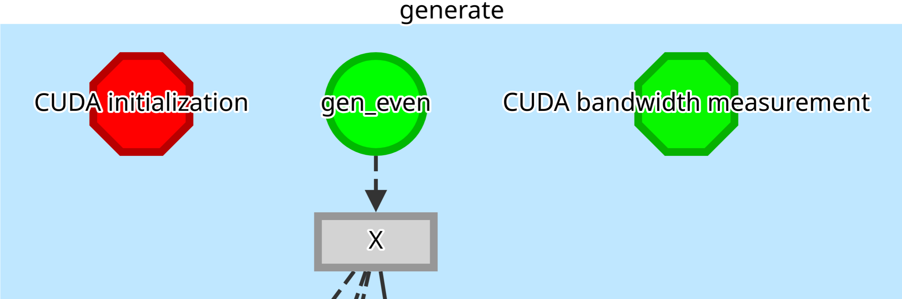
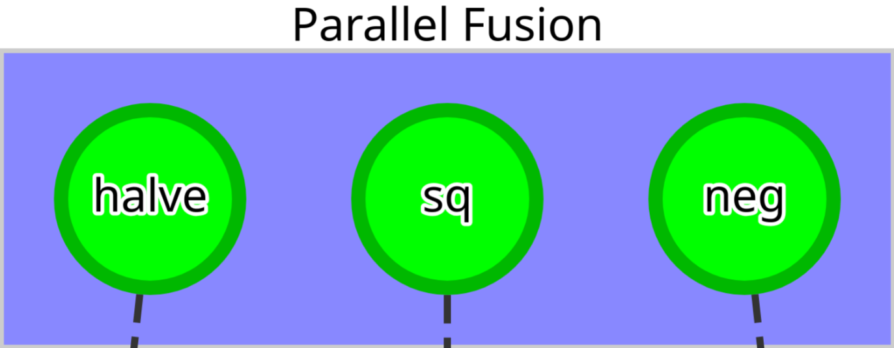
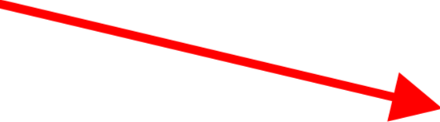
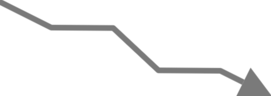
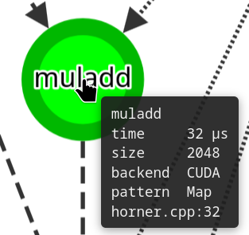
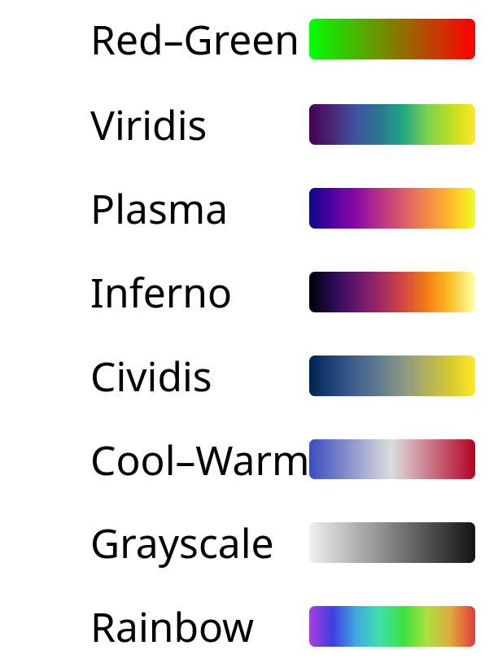
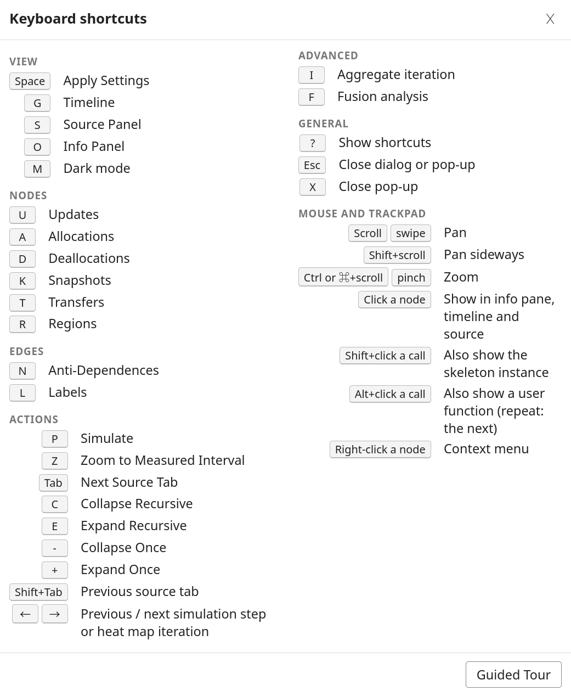
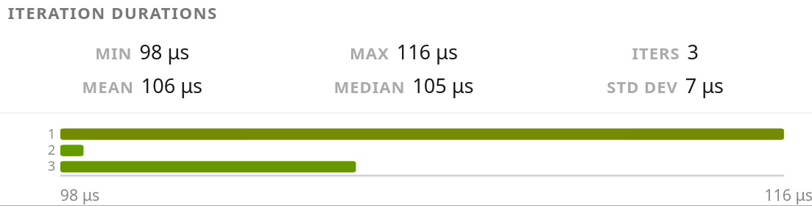
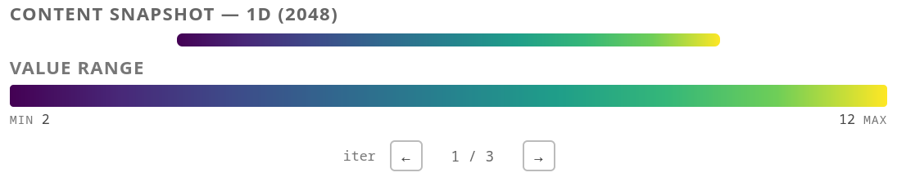

# SkeVU User Manual {#sec-skevu}

SkeVU [@Ernstsson2025SkeVU] is an interactive browser-based visualization tool for SkePU trace files.
It renders the task graph of a SkePU program execution as a directed acyclic graph
(DAG), a timeline (Gantt chart), and an annotated source code view — all
synchronized so that navigating in one view updates the others.

SkeVU comes with SkePU, in the `visualizer/` directory. It is a static web app, so there is
nothing to install or build: it runs directly from the source files.



## Running SkeVU {#sec-setup}

Serve the `visualizer/` directory over HTTP and open it in a browser. Any static file server
works, for instance:

```bash
cd visualizer
python3 -m http.server 5001     # then open http://localhost:5001
```

HTTP is needed because SkeVU does its graph processing and layout in Web Workers, which
browsers do not allow from `file://` URLs. Everything runs in the browser; no trace or source
file leaves your machine.

Optionally, `make skepu-lib` in `visualizer/` copies the SkePU library headers (`skepu-lib/`)
next to the app, so that the source panel can show the library code that a trace refers to,
for instance the SkePU-DNN layers.

## Generating Execution Traces {#sec-tracing}

Tracing is enabled by compiling adding the `-DSKEPU_TRACING` to the precompiler and comnpiler.
When the SkePU program exits, it writes a JSON trace of the skeleton calls,
container operations and data transfers it performed. The file is named `skepu_trace.json` in
the current directory unless another name is given with `-DSKEPU_TRACE_FILE="name.json"` when
compiling (the value is stringified by the preprocessor, so something like `-DSKEPU_TRACE_FILE=trace/horner.json`
also works), or in the `SKEPU_TRACE_FILE` environment variable when running.

A program can also take *snapshots* of the contents of containers, with
`SKEPU_TRACE_SNAPSHOT(container)`, which SkeVU can show as heat maps. Snapshots are only taken if
the program is also compiled with `-DSKEPU_TRACING_SNAPSHOTS` (in addition to `-DSKEPU_TRACING`);
otherwise `SKEPU_TRACE_SNAPSHOT` does nothing. Each snapshot is a file with the whole contents of
the container, so a program that takes them in a loop will write a lot of data to disk and therefore run significantly slower.
The snapshot files are written to the directory given by `-DSKEPU_TRACE_SNAPSHOT_DIR=dir`;
archive its files as a `.zip` to load them.

The example programs of SkePU can be built with tracing as follows (their traces are written
to a `trace/` directory):

- with `make` in `examples/`: the programs are built with tracing (`TRACE` in
  `examples/programs.mk`; `make/skepu.mk` has the rules); add `TRACE_SNAPSHOTS=1` to the `make`
  command to take snapshots too;
- with CMake: configure with `-DSKEPU_EXAMPLES_TRACING=ON`, and also
  `-DSKEPU_EXAMPLES_TRACING_SNAPSHOTS=ON` for snapshots.

Traces carry the file name and line of each call. For the source panel, load the source files
of the program together with the trace.

## Loading a Trace {#sec-loading}

Open the **Files** menu in the menu bar.

| Field | Description |
|---|---|
| **Trace File** | A SkePU JSON trace file (`.json`). Required. |
| **Source File(s)** | One or more `.cpp` / `.hpp` source files. Optional, enables source-line highlighting. |
| **Snapshots (zip)** | A zip archive of container snapshot data files. Optional, enables heatmap visualization in the info pane. |

Click **Load Trace** to load the files. The graph is rendered immediately with the current
settings.

### Example traces

The **Examples** submenu at the top of the Files menu lists the traces shipped in
`visualizer/examples/`, with their source files; selecting one loads it. The entries (a trace per
backend, source files and an optional snapshot archive) are listed in
`visualizer/examples/examples.json`.

---

## Interface Layout {#sec-layout}

The interface is divided into four main areas:

```
┌───────── Menu  ─────────────────────────────────────────────────────┐
│                                                                     │
│  ┌──────────────────────────────────┐  ┌─────────────────────────┐  │
│  │          Graph view (DAG)        │  │    Source / Trace panel │  │
│  │                                  │  │                         │  │
│  ├──────────────────────────────────┤  ├─────────────────────────┤  │
│  │              Legend              │  │       Info pane         │  │
│  └──────────────────────────────────┘  └─────────────────────────┘  │
│  ┌───────────────────────────────────────────────────────────────┐  │
│  │                  Timeline (Gantt chart)                       │  │
│  └───────────────────────────────────────────────────────────────┘  │
└─────────────────────────────────────────────────────────────────────┘
```

- The **vertical divider** between the graph and the source panel can be dragged
  left or right to resize those two areas.
- The **info pane** sits at the bottom of the source panel and can be resized by
  dragging its top edge.
- The **timeline** runs along the bottom of the window.
- A **legend** strip appears below the graph.

The source panel and timeline can each be hidden independently (see
[View menu](#sec-view-menu)).

---

## The Graph View {#sec-graph}

The graph view shows the data-flow DAG of the SkePU execution. Nodes represent
events, and directed edges represent data dependencies between them.

### Node types

| Type | Description | Example |
|---|---|---|
| **Skeleton Call** | Execution of a SkePU skeleton (Map, Reduce, MapReduce, MapOverlap, …). | {#skeleton-call fig-alt="Image of a skeleton call node." width=50%} |
| **External** | An external (non-SkePU) access to a container. | {#skepu-external fig-alt="Image of an external node." width=50%} |
| **Container Update** | A write to a SkePU container after a skeleton call. | {#container-update fig-alt="Image of a container update." width=50%} |
| **Allocation** | Container allocation event. | {#container-allocation fig-alt="Image of a container allocation." width=50%} |
| **Deallocation** | Container deallocation event. | {#container-deallocation fig-alt="Image of a container deallocation." width=50%} |
| **Transfer** | A device↔host data transfer. | {#transfer-to-gpu fig-alt="Image of a transfer to gpu." width=48%} {#transfer-to-cpu fig-alt="Image of a transfer to cpu." width=48%} |
| **Snapshot** | A snapshot of the data in a container at a point in time. | {#snapshot-node fig-alt="Image of a snapshot node." width=50%} |
| **Kernel Build** | Run-time GPU kernel builds. | {#kernel-build fig-alt="Kernel Build." width=50%} |
| **MPI Communication** | MPI calls for communication. | {#mpi-communication-node fig-alt="MPI communication node." width=50%} |
| **Scalar** | A scalar value, e.g. produced by `Reduce`. | {#scalar-node fig-alt="Image of a scalar node." width=50%} |
| **Region** | An instrumented code region (e.g. a loop body or function). Acts as a compound container for the nodes inside it; can be collapsed and expanded (see [Regions](#sec-regions)). | {#skevu-region fig-alt="SkeVU Region." width=100%} |
| **Fusion** | A suggested skeleton fusion group, shown as a compound container. | {#skevu-fusion fig-alt="SkeVU Fusion." width=100%} |

: {tbl-colwidths="[20,50,30]"}

### Edge types

| Type | Description | Example |
|---|---|---|
| **Element-wise** | An element-wise data dependence between a producer and a consumer. | {#elwise-edge fig-alt="Element-wise Edge." width=100%} |
| **Proxy** | A proxy (read-only) dependence. | {#proxy-edge fig-alt="Proxy Edge." width=100%} |
| **Scalar** | A scalar data flow. | {#scalar-edge fig-alt="Scalar Edge." width=100%} |
| **Anti-dependence** | A write-after-read dependence (shown in red). Visible only when **Edges › Anti-Dependences** is enabled. | {#antidependence-edge fig-alt="Anti-dependence Edge." width=100%} |
| **PRNG** | A sequential dependency through a shared random-number generator state. Shown as a zigzag. | {#prng-edge fig-alt="PRNG Edge." width=100%} |
| **Virtual Alias** | A decorative link between container-update nodes that belong to the same virtual container group. Visible only when **Edges › Virtual Datasets** is enabled. | {#virtual-dataset-edge fig-alt="Virtual Alias Edge." width=100%} |
| **Kernel Build** | A dependence between the run-time compilation of a GPU kernel and its related skeleton call. | {#kernel-build-edge fig-alt="Kernel Build Edge." width=100%} |

: {tbl-colwidths="[20,50,30]"}

Pairs of edges running in opposite directions between the same two nodes are merged
into a single bidirectional edge (arrows on both ends) to reduce visual clutter.
Similarly, multiple parallel edges with the same type are grouped into one labelled
`×N`.

### Navigating the graph

| Action | Effect |
|---|---|
| **Scroll wheel** | Pan horizontally and vertically. |
| **(Ctrl/⌘/⊞Win/Super)+Scroll wheel** | Zoom in / out at the cursor position. |
| **Two-finger pinch** (trackpad) | Zoom in / out around the pinch centre. |
| **Click empty canvas** | Deselect all and close the info pane. |
| **Space** | Re-apply current settings and re-render the graph. |

**View › Reset View** (or re-applying settings) re-runs the automatic layout and
fits the graph to the window.

**Actions › Save Graph as Image** exports the current graph as a PNG file.

### Selecting a node

**Clicking** a node:

- Highlights the node with a coloured border in the graph.
- Highlights all directly connected edges.
- Scrolls the **timeline** to centre the corresponding bar.
- Highlights the corresponding **source line** in the source panel (or the
  corresponding entry in the trace JSON tab) and switches to the correct file tab.
- Opens the **info pane** with metadata about the node.

### Regions {#sec-regions}

Region nodes act as collapsible groups. All nodes created inside an instrumented
code region are nested inside the corresponding region node.

| Action | Effect |
|---|---|
| **Double-click** a region node | Toggle collapsed / expanded. |
| **Actions › Selected Node › Collapse Recursive** (`C`) | Collapse the selected region and all nested regions. |
| **Actions › Selected Node › Expand Recursive** (`E`) | Expand the selected region and all nested regions. |
| **Actions › Selected Node › Collapse Once** (`-`) | Collapse the selected region without affecting nested ones. |
| **Actions › Selected Node › Expand Once** (`+`) | Expand the selected region one level. |
| **Actions › All Regions › Collapse** | Collapse all regions at once. |
| **Actions › All Regions › Expand Once** | Expand every region one level. |
| **Actions › All Regions › Expand Recursive** | Expand all regions and the regions nested in them. |

When a region is collapsed, its child nodes are hidden from the graph.
Edges that cross the region boundary are *promoted*: they appear as edges
connecting directly to the collapsed region node rather than the hidden internal
node.

Collapse state is preserved across re-renders. The timeline and source badges
always show all nodes regardless of collapse state; nodes inside collapsed regions
are rendered at reduced opacity to distinguish them from currently visible ones.

Traces with **fewer than 200 events** have all regions pre-expanded on first
load, since the full structure fits comfortably on screen. Larger traces start
with all regions collapsed so the initial view is not overwhelming.

When the **Regions** toggle is turned off (see [Nodes menu](#sec-nodes-menu)),
region containers are hidden from the graph but still used internally by the
layout engine to keep related nodes together. As a result, the graph structure
will look similar whether regions are displayed or not.

### Hover tooltips

Hovering over a node or edge shows a tooltip with a brief summary (label, type,
duration, backend, etc.).

{#hover-example style="border: 2px solid black;" fig-alt="Hover example." width=30%}

---

## Menu Bar {#sec-menus}

Items marked *web* are present only in the web version, items marked *extension* only in the VS Code extension. Where an item has a key, the key is given in parentheses.

### Files {#sec-files-menu}

Web version only. See [Loading a Trace](#sec-loading).

### View {#sec-view-menu}

| Item | Description |
|---|---|
| **Dependence DAG** / **Program Tree** | Graph mode: the data-flow graph of the run, or the call tree of the program. |
| **Reset View** | Re-run the layout and fit the graph to the window; settings are unchanged. |
| **Scroll Behaviour** | **Pan**: the wheel and a two-finger swipe pan the graph. **Zoom**: they zoom it. Shift+wheel always pans sideways; Ctrl or ⌘+wheel and pinch zoom in the pan mode. |
| **Legend** | Show or hide the colour legend below the graph. |
| **Timeline** (`G`) | Show or hide the Gantt chart. |
| **Source Panel** (`S`) | Show or hide the source panel (web). |
| **Info Panel** (`O`) | Whether the info panel opens when a node is selected. |
| **Progress Bar** | Show the position of the selected node, or of the [simulation](#sec-simulation), in the run. |
| **Source Code ›** | *Web.* **Code Paths**: arrows for the execution order in the source view. **Definitions**: mark where skeleton instances and user functions are defined. **Theme ›**: syntax-highlighting theme. |
| **Dark mode** (`M`) | Toggle between light and dark appearance (web). |
| **Apply Settings** (`Space`) | Fetch the graph from the trace worker with the current settings and re-run the layout. |
| **Restore Defaults** | Reset all settings to their defaults and re-render. |

### Nodes {#sec-nodes-menu}

#### Aggregate (`I`) {#sec-aggregate}

Merges the iterations of a loop into one node that shows accumulated timing statistics. The key toggles between **Off** and **By Name**.

| Mode | Description |
|---|---|
| **Off** *(default)* | Every call and every iteration is a node of its own. |
| **By Name** | Operations of one region with the same name are merged, wherever in the source they are called. |
| **By Name and Location** | Operations with the same name are merged only if they are called from the same source line. |

#### Node types

| Toggle | Key | Description |
|---|---|---|
| **Updates** | `U` | Container write nodes (shown after skeleton calls when data-flow edges are disabled). |
| **Allocations** | `A` | Container allocation events. |
| **Deallocations** | `D` | Container deallocation events. |
| **Snapshots** | `K` | Container snapshots. |
| **Transfers** | `T` | Device↔host data transfers. |
| **Kernel Builds** | — | Run-time GPU kernel builds. |
| **Communications** | — | MPI calls (e.g. bcast, gather). Present for MPI traces. |
| **Element Accesses** | — | Scalar element-access nodes. |
| **Regions** | `R` | Instrumented regions as compound nodes (see [Regions](#sec-regions)). |
| **Fusion Candidates** | `F` | Mark chains of calls that could be fused into one (see [Fusion Analysis](#sec-fusion)). |

**Fusion Options ›** modify the analysis: **Ignore Regions** fuses calls across region boundaries and **Ignore Snapshots** does not let a snapshot of a container stop its fusion. Regions and snapshots exist only in traced runs.

#### Color {#sec-nodes-color}

The metric mapped to the colour of skeleton-call and external-access nodes.

| Mode | Description |
|---|---|
| **Total Time** *(default)* | Execution time accumulated over all iterations. |
| **Elements** | Number of elements processed (product of all dimensions). |
| **Time/element** | Execution time per element. |
| **Iterations** | Number of executions of the node (relevant with [Aggregate](#sec-aggregate) on). |
| **Duration Variance** | Variance in duration between the iterations of an aggregated call. |
| **Rank Imbalance (MPI)** | Variance in execution time of identical calls across MPI ranks. |
| **Busiest Rank's Bytes (MPI)** | Bytes sent plus received by the rank that moves the most, averaged over the iterations of a call. |
| **DAG Depth** | Longest-path depth in the dependence graph. |
| **Program Sequence** | Position in the execution order of the trace. |
| **Pattern** | Skeleton pattern (Map, Reduce, …); each pattern has a fixed colour. |
| **Backend** | Execution backend (CPU, OpenMP, CUDA, OpenCL); each backend has a fixed colour. |

#### Size

The metric mapped to node size.

| Mode | Description |
|---|---|
| **Fixed** *(default)* | All nodes the same size. |
| **Total Time** | Larger nodes ran longer. |
| **Elements** | Larger nodes processed more elements. |
| **Time/element** | Larger nodes had a higher per-element cost. |
| **Iterations** | Larger nodes were executed more times. |
| **Duration Variance** | Larger nodes varied more in duration between iterations. |

#### Color Spectrum

The colour scale for nodes and Gantt bars (see [Color](#sec-nodes-color)).

:::: {.columns}
::: {.column width="76%"}
* **Red–Green** *(default)* --- Low = green, high = red.
* **Viridis** --- Perceptually uniform; suitable for colour-blind users.
* **Plasma** --- High-contrast sequential.
* **Inferno** --- Sequential, for dark backgrounds.
* **Cividis** --- Colour-blind-safe sequential.
* **Cool–Warm** --- Diverging blue–red.
* **Grayscale** --- Monochrome.
* **Rainbow** --- Rainbow.
:::
::: {.column width="24%"}
{#skevu-colors fig-alt="Colors." width=100%}
:::
::::

### Edges {#sec-edges-menu}

| Item | Description |
|---|---|
| **Anti-Dependences** (`N`) | Write-after-read hazard edges (red). |
| **Virtual Datasets** | Decorative links between container updates in the same virtual-alias group. |
| **Labels** (`L`) | Container names on edges. |
| **Direction** | **Vertical** (top to bottom, default) or **Horizontal** (left to right). |
| **Width** | Metric mapped to edge width. |
| **Opacity** | Metric mapped to edge opacity. |

**Width** and **Opacity** have the same modes:

| Mode | Description |
|---|---|
| **Fixed** *(default)* | All edges the same. |
| **Elements** | Number of elements exchanged across the edge. |
| **Iterations** | Number of traversals of the edge. |
| **Program Order Span** | Distance in program order between the source and target nodes; long-range dependences stand out. |
| **Critical Path** | Edges on the critical path are thick or opaque, the others thin or faded. |
| **Cross-Backend** | Edges that cross a backend boundary (e.g. CPU → OpenCL) are thick or opaque, the others thin or faded. |

### Actions {#sec-actions-menu}

| Item | Description |
|---|---|
| **Simulate** (`P`) | Play back the trace node by node in execution order, highlighting each node in all views. See [Simulation Mode](#sec-simulation). |
| **Save Graph as Image** | Export the graph as a PNG file. |
| **Next Source Tab** (`Tab`) | Cycle forward through the source tabs (web). `Shift+Tab` cycles backward. |
| **Selected Node ›** | **Collapse Recursive** (`C`), **Expand Recursive** (`E`), **Collapse Once** (`-`), **Expand Once** (`+`) for the selected region. |
| **All Regions ›** | **Collapse**, **Expand Once**, **Expand Recursive** for every region. |
| **All Fusions ›** | **Collapse**, **Expand** for every fusion group. |

See [Regions](#sec-regions) for the semantics of collapsing and expanding.

### ? Help button

Shows the keyboard shortcuts, from which the **Guided Tour** can be started.

{#info-screen style="border: 2px solid black;" fig-alt="Info screen." width=50%}

### ⓘ Info button

Trace statistics for the loaded graph:

- Number of trace events, graph nodes, edges, timeline bars and snapshot files.
- Server-side analysis time, client-side rendering time and total response time.

While the graph is being laid out, a **Rendering…** indicator in the menu bar offers **Stop rendering**.

---

## Fusion Analysis {#sec-fusion}

Fusion analysis (enabled via **Nodes › Fusion Candidates** or `F`) identifies
skeleton calls whose intermediate data could be eliminated by merging them into a
single kernel pass — a common compiler optimization for data-parallel programs.
The analysis runs in the trace worker whenever the graph is rendered with the option
enabled and its results are overlaid on the graph without altering the underlying
trace data.

Detected groups are shown as **Fusion** compound nodes (blue rounded containers)
enclosing their member skeleton calls. The same groups also appear in the **Actions
› All Fusions** collapse/expand menu item.

### Kinds of fusion

**Parallel fusion** — two or more Map skeleton calls that operate on the same
domain and have no ordering constraint between them.  Because they access data
independently they can be merged into a single pass over the data.  The info pane
for a parallel fusion node shows the element sizes of the participating Maps and
whether they all share the same domain (Uniform elements: yes / no).  Non-uniform
sizes can still be fused but may require size specialisation in the generated code.

**Serial fusion** — a chain of skeleton calls where each call's output is consumed
element-wise by the next with no other consumers.  The chain can be fused into a
single kernel that avoids writing and re-reading the intermediate containers.
Supported chain patterns:

| Pattern | Description |
|---|---|
| **Map → Map → …** | Arbitrary-length chain of Maps. |
| **Map → Reduce** | One or more Maps feeding a Reduce; fused into a MapReduce-style kernel. |
| **Map → MapReduce** | Maps feeding a combined map-reduce stage. |
| **Map → MapOverlap** | Maps feeding a stencil stage. |

The **Fusion pattern** shown in the info pane for a serial fusion node is the
pattern of the *sink* (final) skeleton in the chain and indicates what type of
fused kernel would be generated.

### Fan-out prevention

A skeleton whose output is consumed by **more than one** downstream skeleton cannot
be included in a fusion chain — the intermediate result must be materialised so
both consumers can read it.  The analysis detects this automatically and excludes
the shared producer from any fusion group.

### Interpretation

Fusion groups are *suggestions*, not guarantees.  Whether a given fusion is
profitable in practice depends on arithmetic intensity, cache effects, and compiler
support.  The visualization is intended to help identify candidates that are worth
investigating; the actual optimization would be applied separately at the SkePU
compiler level.

---

## The Timeline {#sec-timeline}

The Gantt chart at the bottom of the window shows the real-time execution of the
trace on a shared time axis. It is always rendered from all trace nodes regardless
of collapse state in the graph; nodes inside collapsed regions are shown at reduced
opacity.

### Rows

| Row | Content |
|---|---|
| **Regions** *(top row)* | One bar per instrumented region per iteration. Coloured by nesting depth. |
| **CPU / OpenMP / CUDA / …** | One row per backend. Each row contains bars for skeleton calls and external accesses executed on that backend. |
| **Transfers** | Bars for device↔host data transfers. |
| **Events** | Star markers for allocation (white star) and deallocation (black star) events. |

### Interacting with the timeline

**Click a bar or marker** — selects the corresponding node in the graph, highlights
the source line, and opens the info pane.

**Click empty timeline area** — sets the *locked cursor line* at that time
position. A labelled vertical line marks the time offset from the start of the
trace. Click again to move it.

**Hover** — a second *hover cursor line* tracks the mouse. When the locked cursor
is set, a double-headed arrow and a value appears between the two lines,
measuring the elapsed time between them.

**Drag** pans the timeline and **Shift+drag** zooms to the dragged range.
**Ctrl or ⌘+wheel** and pinch zoom; the vertical zoom slider (1× – 1000×) sets the
scale, and a double-click on it resets to 1×.

---

## The Source Panel {#sec-source}

The source panel on the right side of the window shows the loaded source files
and the trace JSON, each in its own tab. Source code is syntax-highlighted.

### Tabs

- One tab per loaded source file (`.cpp` / `.hpp`).
- A final tab showing the raw SkePU trace JSON (`.json` / `.skevu`).

Switch tabs with the tab buttons, or with the `Tab` / `Shift+Tab` keyboard
shortcuts (or **Actions › Next Source Tab**).

### Line highlighting

When a node is selected (by clicking in the graph, timeline, or via a badge),
the source panel automatically:

1. Switches to the tab corresponding to the node's source file.
2. Scrolls to and highlights the source line where the skeleton call or region
   was declared.

If the **trace JSON tab** is currently active, the selection instead highlights
the lines of the JSON entry that produced the selected node.

### {#skevu-badge fig-alt="Badge." width=2%} Source badges {#sec-badges}


After the graph is rendered, numbered badge pills appear in the line-number gutter
of each source file next to lines that correspond to one or more trace events.

- The number on the badge is the **total count** of trace events (including all
  iterations when aggregation is off) originating from that line.
- **Clicking** a badge selects the corresponding node in the graph, scrolls the
  timeline, and opens the info pane. If multiple nodes or iterations share the
  same source line, successive clicks **cycle** through them.
- Badges for nodes that are currently **hidden** (inside collapsed regions) are
  rendered at reduced opacity. If some events at a line are visible and some are
  hidden, the visible count appears at full opacity and the hidden count appears
  dimmed (e.g. `3` `+2`).
- Equivalent badges appear in the gutter of the **trace JSON tab**, positioned at
  the first line of the relevant trace entry.

---

## The Info Pane {#sec-info}

The info pane opens at the bottom of the source panel when a node is selected.
It shows metadata computed by the trace worker for that node. The pane can be resized
by dragging its top edge, and closed with `x` or `Escape`.

### Node information

Displayed fields depend on node type and may include:

| Field | Description |
|---|---|
| **Label** | Container or skeleton name. |
| **Duration** | Total execution time (formatted as µs / ms / s). |
| **Backend** | Execution backend (CPU, OpenMP, CUDA, OpenCL). |
| **Pattern** | SkePU skeleton pattern (Map, Reduce, MapOverlap, …). |
| **Elements** | Data dimensions processed. |
| **File / Line** | Source location. |
| **Repeat count** | Number of iterations (when aggregation is on). |
| **Region / Nesting Level** | Enclosing region and its depth (for nested nodes). |
| **Version** | Write version for container-update nodes. |
| **Direction** | Transfer direction (device-to-host / host-to-device). |
| **Instance** | The location of the skeleton instance construction. |
| **User function** | The location of the user funtion(s) used in the skeleton. |
| **Fusion pattern** | The skeleton pattern of the sink stage in a fusion group (Map, Reduce, MapReduce, or MapOverlap). Shown on Fusion nodes when **Fusion Candidates** is enabled. |

### Duration plot

{#iteratio-durations style="border: 2px solid black;" fig-alt="Duration plot." width=50%}

For skeleton-call and external nodes executed more than once (aggregated
iteration mode), the info pane shows a horizontal bar chart of per-iteration
durations. Summary statistics (min, max, mean, median, standard deviation) are
displayed above the chart.

Bars are coloured using the current colour spectrum on the same global duration
scale as the graph nodes. **Clicking a bar** scrolls the timeline to the
corresponding iteration interval.

### Container snapshot heatmap {#sec-heatmap}

{#content-snapshot style="border: 2px solid black;" fig-alt="Container snapshot." width=50%}

If snapshot data files were loaded, selecting a **Container Update** node that has
an associated snapshot displays a 2D heatmap of the container contents at that
point in the execution.

- For multi-dimensional containers, navigation controls above the heatmap select
  which slice to display.
- For nodes with multiple snapshots (multiple iterations), an **iteration bar**
  at the bottom selects which snapshot to view.
- `←` / `→` on the keyboard or in the visualizer (see figure above) to navigate between slices or snapshots while the heatmap is active.

---

## Simulation Mode {#sec-simulation}

Simulation mode replays the trace in execution order, visiting each event one
step per second and synchronizing all views.

### Controls

| Action | Effect |
|---|---|
| **Actions › Simulate › Play** (`p`) | Start playback from the beginning, or resume after a pause. |
| **Actions › Simulate › Pause** (`p` again) | Pause playback at the current position. |
| **Actions › Simulate › Stop** | Stop playback and reset to the beginning. |
| `←` / `→` | Step backward / forward one event while paused. |

### Progress bar

A progress bar appears at the bottom of the graph view when the simulation is
active. The bar shows the current position as a fraction of the total event
sequence.

- **Click** anywhere on the bar to jump to that point in the sequence.
- **Drag** along the bar to scrub through events continuously. Animations are
  suppressed while dragging to keep the UI responsive.
- **Clicking a Gantt bar** while the simulation is active jumps to the
  corresponding event and pauses playback.

Region and fusion nodes are skipped; only events with a direct trace-event
counterpart are visited.

---

## Keyboard Shortcuts {#sec-keyboard}

Shortcuts are active when the focus is not on a text input field. Modifier keys
(Alt, Ctrl, Cmd) are not used.

### Settings

| Key | Action |
|---|---|
| `Space` | Apply Settings |
| `a` | Toggle Allocations |
| `d` | Toggle Deallocations |
| `n` | Toggle Anti-Dependences |
| `t` | Toggle Transfers |
| `r` | Toggle Regions |
| `u` | Toggle Updates |
| `l` | Toggle Edge Labels |
| `i` | Toggle Aggregate (Off / By Name) |
| `f` | Toggle Fusion Candidates |

### Views

| Key | Action |
|---|---|
| `g` | Toggle Timeline |
| `s` | Toggle Source Panel |
| `m` | Toggle Dark Mode |
| `Tab` | Next Source Tab |
| `Shift+Tab` | Previous Source Tab |

### Graph navigation

| Key | Action |
|---|---|
| `e` | Expand selected region (recursive) |
| `c` | Collapse selected region (recursive) |
| `+` | Expand selected region (one level) |
| `-` | Collapse selected region (one level) |

### Simulation

| Key | Action |
|---|---|
| `p` | Play / Pause |
| `←` | Step backward (while paused) |
| `→` | Step forward (while paused) |

### Info pane

| Key | Action |
|---|---|
| `←` / `→` | Navigate heatmap slices or snapshot iterations |
| `x` or `Escape` | Close info pane |

---

## Settings Persistence {#sec-settings}

All settings (node/edge visibility, colour mode, direction, aggregation flags,
panel visibility, dark mode, source code theme, pane sizes, colour spectrum, and
Gantt scale) are automatically saved to the browser's `localStorage` and restored
on the next page load. Settings are stored per browser and are not shared between
machines.

**View › Restore Defaults** resets all settings to their factory values and
immediately re-renders.

### Auto-render threshold

For graphs with **200 nodes or fewer**, every setting change triggers an immediate
re-render. For larger graphs, changing a setting shows a warning banner asking you
to apply settings manually with `Space` or **View › Apply Settings**. This
prevents slow re-renders during rapid checkbox toggling.

---

## Rendering Indicator

While the trace worker is processing a request or the layout engine is running, a
**Rendering…** spinner appears in the menu bar. Opening the indicator dropdown
reveals a **Stop rendering** button, which cancels the in-flight request and
layout computation. The same button is also accessible as an overlay on the graph
canvas during layout.
